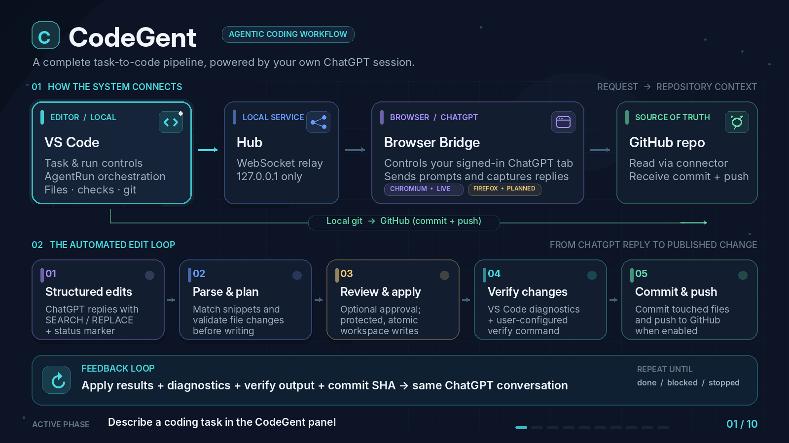

# CodeGent

### Agentic coding on a free ChatGPT account.

Tell VS Code what you want built. ChatGPT reads your code on GitHub and answers with changes.
CodeGent applies them, checks them, and sends the result back to ChatGPT for the next step —
again and again until the task is done. **No API keys. No copy and paste.**

  

**[⬇ Download the latest release](https://github.com/MohammadAsadolahi/CodeGent/releases/latest)** — the VS Code extension and the browser extension.

> **Early release (0.1.0).** It works end to end, but it was built on Windows and controls a web page
> it does not own, so rough edges are expected. [Known problems](docs/troubleshooting.md#known-limitations)

## Get started in 3 steps

**You need:** VS Code, a project that is a git repository on GitHub, a browser
(Chrome, Edge or Brave, Firefox), and a free ChatGPT account with the GitHub connector turned on so ChatGPT can see the repository you want to develop.

1. **Install the VS Code extension.** Download `codegent-0.1.0.vsix` from the
   [latest release](https://github.com/MohammadAsadolahi/CodeGent/releases/latest) (or build it with `npm run package`) and run
   `code --install-extension codegent-0.1.0.vsix`.
2. **Install the browser extension.** Open the CodeGent panel in VS Code, find the folder it shows under
   _Browser extension_, then in your browser go to `chrome://extensions` → turn on **Developer mode** →
   **Load unpacked** → pick that folder. (Or unzip `codegent-bridge-browser-extension-0.1.0.zip` from the
   release and pick the unzipped folder.)
3. **Sign in to ChatGPT.** Open [chatgpt.com](https://chatgpt.com) in the same browser, sign in, and
   connect the **GitHub** connector to your repository.

The panel has a checklist that turns green as each part is ready.

## Use it

1. Open the CodeGent panel and describe what you want.
2. Press **Start**.
3. Watch each step appear. You can open every changed file, see the diff, **Undo** a step, or **Stop**
   at any time.

Each new run opens its **own ChatGPT tab**, preserving earlier conversations. Follow-up steps
stay in the same tab and chat. Expand **History** in CodeGent to view saved step summaries and
reopen a past ChatGPT conversation. The most recent 30 runs are kept locally; **Clear history**
removes those records. An interrupted run can be inspected but cannot automatically resume.

Tip: set a **verify command** such as `npm test` ([settings](docs/settings.md)) so ChatGPT gets real
test results after every step.

## Is it safe?

- ChatGPT only sends text back. It cannot run anything on your computer.
- Every edit is checked before it is written. Files you have changed yourself are left alone.
- Everything is undoable, and the number of steps is capped.
- No CodeGent server and no telemetry. Your code goes only to ChatGPT, through your own account, and to GitHub.

Details: [Safety and privacy](docs/safety-and-privacy.md) — including a note that automating a web page
may not be allowed by the service's terms.

## Learn more

| Topic                      | Where                                         |
| -------------------------- | --------------------------------------------- |
| Something is not working   | [Troubleshooting](docs/troubleshooting.md)    |
| All options                | [Settings](docs/settings.md)                  |
| What happens in one step   | [A step, explained](docs/how-a-step-works.md) |
| How the parts fit together | [Architecture](docs/architecture.md)          |
| Build it, run the tests    | [Development](docs/development.md)            |

## FAQ

**Can I use ChatGPT Free for this?** That is the goal: it runs in your own signed-in tab, without an
API key. Message limits and GitHub connector access depend on OpenAI's plans and region, and CodeGent
does not remove any limit.

**Does ChatGPT change my files or run commands?** No. CodeGent applies validated edits itself.

**Is it affiliated with OpenAI, GitHub or Microsoft?** No. It is an independent community project.

## Contribute

CodeGent is free to use, and contributions are welcome. Testing the install on macOS or Linux,
reporting where you got stuck, and improving these docs are all valuable — start with
[CONTRIBUTING.md](.github/CONTRIBUTING.md). Ask questions in
[Discussions](https://github.com/MohammadAsadolahi/CodeGent/discussions), report problems as
[issues](https://github.com/MohammadAsadolahi/CodeGent/issues/new/choose), and follow the
[Code of Conduct](.github/CODE_OF_CONDUCT.md).

If CodeGent helps you, a star helps others find it.
